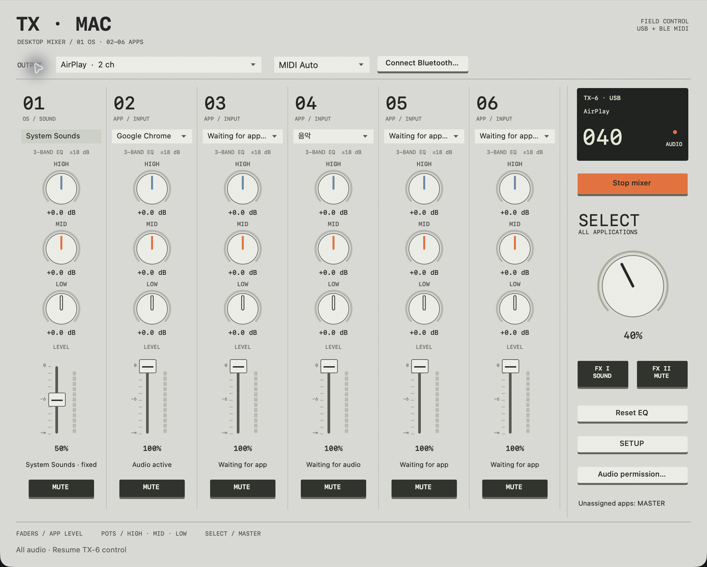

# tx-mac

A macOS mixer controlled with a teenage engineering TX-6 over USB or Bluetooth MIDI.



Requires macOS 26. Building requires Xcode Command Line Tools.

```sh
./install.command
```

## TX-6 setup

| Setting | Value |
| --- | --- |
| USB | 12 IN |
| MIDI → CTRL | OUT |
| BLE | ACCEPT for wireless MIDI |
| SOLO | MUTE |
| VU METER | PRE |
| SYNTH | OFF |
| DJ | OFF |

Allow system audio access on first launch. MAIN follows the Mac's default output unless you select a device. Bluetooth carries MIDI controls only.

Keep **USB 12 IN** selected. Optional USB channel meters mirror six app channels while listening through the Mac or AirPlay. The feed has a +3 dB boost with peak limiting; MAIN and MONITOR are unchanged. Mirroring is unavailable for individual Chrome tabs or when TX-6 is an audio output.

Meters show signal level, not the master number. TX-6's own faders still affect its USB mix return.

Choose a MONITOR device and set each channel to Main, Monitor, Both or Off. Preview follows EQ, fader, mute and master. FX1 unmutes master; FX2 mutes both outputs. A disconnected monitor stays silent.

TX-6 audio output uses one stereo pair. Six-track output and native AUX/CUE routing are not supported.

On the TX-6 home screen, press and release SHIFT to enable the SELECT master knob. Align the device's master number manually in setup.

SCENE saves assignments, levels, EQ, mute and routing, keeping master and FX2 unchanged. Saved scenes wait for unavailable outputs. Create app groups from a channel's app menu. Levels shows sample peaks and limiter activity; Reset clears peak history.

Chrome-wide volume and EQ work without an extension. For individual tabs, load `BrowserExtension` and enable tab mode in settings. Audible tabs appear automatically; tab volume and EQ require the extension button or `Command+Shift+6` once per tab.

Released under [CC0 1.0 Universal](LICENSE).
